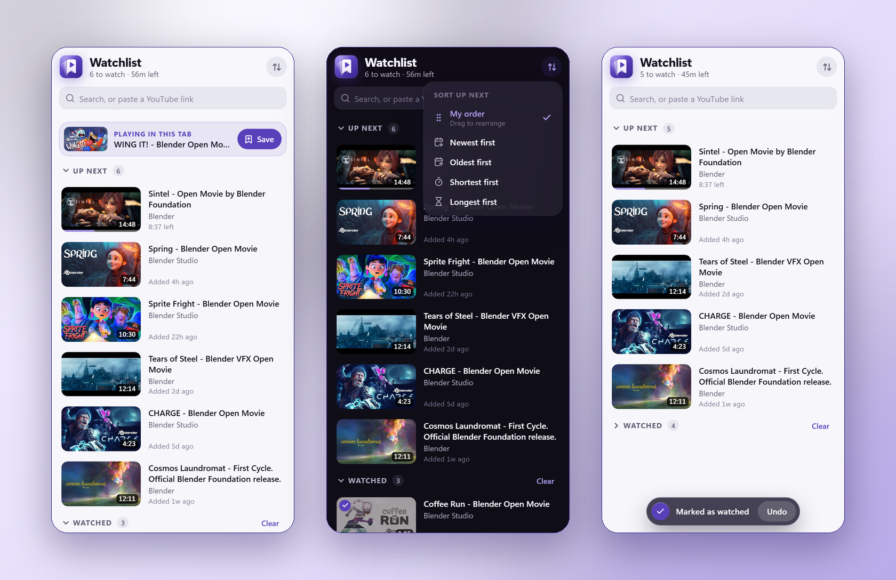
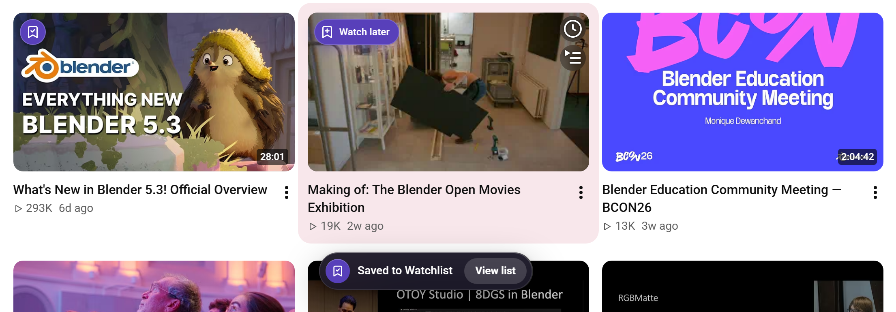
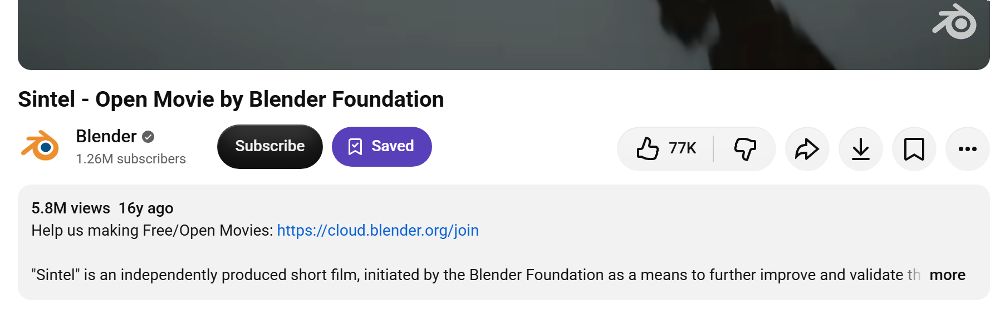
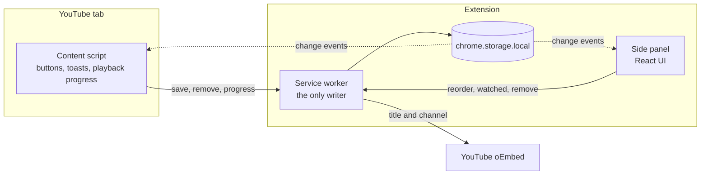

<p align="center">
  
</p>

<h1 align="center">Watchlist</h1>

<p align="center">
  A watch-later list for YouTube that lives in your browser's side panel.<br>
  Save a video with one click, pick it up again where you stopped.
</p>

<p align="center">
  
  
  
</p>

<p align="center">
  
</p>

## Contents

- [Features](#features)
- [Installation](#installation)
- [Usage](#usage)
- [How it works](#how-it-works)
- [Project structure](#project-structure)
- [Development](#development)
- [Permissions and privacy](#permissions-and-privacy)
- [Browser support](#browser-support)
- [Third-party software](#third-party-software)

## Features

**Saving**

- A bookmark button on every YouTube thumbnail: home, search, channel pages, the watch-page sidebar and Shorts shelves.
- A **Watch later** button next to Subscribe on the watch page.
- **Save to Watchlist** in the right-click menu for YouTube links on any website.
- A keyboard shortcut for the video you are watching, and paste-a-link in the panel.

**The list**

- Opens in the browser's side panel when you click the toolbar icon, and stays open as you browse.
- **Up next** and **Watched** sections that collapse and expand.
- Drag to reorder, or sort by date added or by length.
- Search by title or channel.
- Every removal can be undone.

**Playback**

- Remembers how far you got in each saved video and resumes from there.
- Checks a video off automatically when you finish it.
- Shows the number of unwatched videos on the toolbar icon.

**Design**

- Light and dark themes that follow the system setting.
- Spring-based motion throughout, with reduced-motion, reduced-transparency and high-contrast preferences respected.

<p align="center">
  
</p>

<p align="center">
  
</p>

## Installation

Watchlist is loaded as an unpacked extension. Nothing needs to be compiled.

1. Get the code:

   ```sh
   git clone https://github.com/Imesh-Madushan-Dev/yt-watchlist.git
   ```

   Or choose **Code → Download ZIP** on GitHub and extract it.

2. Open `chrome://extensions` (in Edge, `edge://extensions`).
3. Turn on **Developer mode**.
4. Click **Load unpacked** and select the `yt-watchlist` folder.
5. Pin **Watchlist** to the toolbar.

If the buttons do not appear on a YouTube tab that was already open, reload that tab.

## Usage

| To | Do this |
| --- | --- |
| Save a video | Hover a thumbnail on YouTube and click the bookmark |
| Save the video you are watching | Click **Watch later** next to Subscribe, or press <kbd>Alt</kbd>+<kbd>Shift</kbd>+<kbd>S</kbd> |
| Save from another website | Right-click a YouTube link and choose **Save to Watchlist** |
| Add a video by link | Paste the link into the panel's search box and click **Save** |
| Open or close the list | Click the toolbar icon, or press <kbd>Alt</kbd>+<kbd>Shift</kbd>+<kbd>W</kbd> |
| Play a video | Click it in the panel. <kbd>Ctrl</kbd>-click or middle-click opens it in a new tab |
| Reorder the queue | Drag a row while the list is sorted by **My order** |
| Mark as watched, or remove | Hover a row and use the check or trash button |
| Remove a saved video from YouTube | Click its bookmark again |

Clicking a video plays it in the current tab when that tab is on YouTube, and in a new tab otherwise.

Both shortcuts can be changed at `chrome://extensions/shortcuts`.

## How it works



- **One writer.** Every change goes through the service worker, which applies writes one at a time. Two tabs saving at the same moment cannot overwrite each other.
- **Storage is the source of truth.** The page and the panel never talk to each other directly. Both listen for storage changes, so a video saved on YouTube appears in an open panel straight away, and a video removed in the panel loses its saved mark on the page.
- **Buttons never cache a video.** YouTube is a single-page app that reuses its DOM nodes for different videos. Each button reads the video ID from its link at the moment it is clicked.
- **The hover preview is covered.** Shortly after you hover a thumbnail, YouTube lays a playing preview over it. The preview gets its own copy of the button in the same position, so the control stays under the pointer.
- **Metadata is corrected in the background.** The title and channel read from the page are shown at once, then replaced with the values from YouTube's oEmbed endpoint.

## Project structure

```
manifest.json              Extension manifest (Manifest V3)
background.js              Service worker: storage writes, context menu, shortcuts, badge
shared/
  core.js                  URL parsing and formatting helpers shared by every part
content/
  content.js               Runs on youtube.com: buttons, toasts, progress tracking
  content.css              Styles for the above, all prefixed ytwl-
sidepanel/
  index.html               Side panel page
  app.js                   Panel UI
  tailwind.config.js       Theme: brand colour, fonts, spring easing
  styles.css               Colour tokens for light and dark, materials
icons/                     SVG sources and the rendered PNGs
vendor/                    Third-party libraries, shipped with the extension
tools/
  make-icons.mjs           Renders the PNG icons from the SVG sources
docs/                      Images used in this README
```

## Development

There is no build step. Edit a file, then click the reload button on the extension's card at `chrome://extensions`. Changes to the content script also need the YouTube tab reloaded.

### Stack

| Part | Built with |
| --- | --- |
| Side panel | React 18, Framer Motion, lucide-react, Tailwind CSS (Play CDN build), written with [htm](https://github.com/developit/htm) templates instead of JSX |
| YouTube page | Plain JavaScript and hand-written CSS, with inline Lucide icons |
| Service worker | Plain JavaScript |

The page-side code avoids Tailwind on purpose: its reset styles would restyle YouTube itself.

### Why the libraries are in `vendor/`

Manifest V3 does not let an extension page load scripts from another origin, so a `<script src="https://cdn.tailwindcss.com">` tag is blocked. The same script is shipped inside the extension instead and behaves identically. The other libraries are bundled for the same reason.

The Tailwind CDN build only generates CSS for classes it has seen in the page. To keep parts that appear later, such as the sort menu and toasts, from showing unstyled for a frame, `app.js` passes its own source to Tailwind at startup so every class is compiled before the panel is shown.

### Icons

Edit `icons/icon.svg` (used at 48 and 128 px) or `icons/icon-small.svg` (16 and 32 px), then run:

```sh
node tools/make-icons.mjs
```

The script uses a Chromium-based browser that is already installed. Set the `BROWSER` environment variable to its path if it is not found.

### Packaging

**Pack extension** at `chrome://extensions` produces a `.crx` file and a `.pem` file. The `.pem` is the private key that signs the extension: keep it somewhere safe and never commit it. Both file types are listed in `.gitignore`.

## Permissions and privacy

| Permission | Used for |
| --- | --- |
| `storage` | Keeping the list and your panel preferences on this device |
| `sidePanel` | Showing the list in the browser's side panel |
| `contextMenus` | The **Save to Watchlist** entry in the right-click menu |
| `scripting` | Adding the buttons to YouTube tabs that were open before the extension was installed |
| `https://www.youtube.com/*` | Adding the buttons to YouTube pages and looking up video titles |

The list is stored locally with `chrome.storage.local`. It is not synced and is not sent anywhere. There is no account, no analytics and no tracking.

The extension makes one kind of network request: a call to YouTube's public oEmbed endpoint to fetch the title and channel name of a video you save. Thumbnails are loaded from YouTube's image servers when the panel is open.

## Browser support

Chrome, Edge, Brave and other Chromium-based browsers, version 116 or newer. Firefox and Safari are not supported, because the extension depends on the Chromium side panel API.

## Third-party software

| Library | Version | License |
| --- | --- | --- |
| [Tailwind CSS](https://tailwindcss.com) (Play CDN build) | 3.4.17 | MIT |
| [React](https://react.dev) and React DOM | 18.3.1 | MIT |
| [Framer Motion](https://www.framer.com/motion/) | 11.18.2 | MIT |
| [lucide-react](https://lucide.dev) | 0.468.0 | ISC |
| [htm](https://github.com/developit/htm) | 3.1.1 | Apache-2.0 |

The videos shown in the screenshots are from the Blender and Blender Studio YouTube channels and are © Blender Foundation. Its [open movies](https://studio.blender.org/films/) are published under Creative Commons licences.

---

Watchlist is an independent project. It is not affiliated with, endorsed by, or sponsored by YouTube or Google. YouTube is a trademark of Google LLC.
